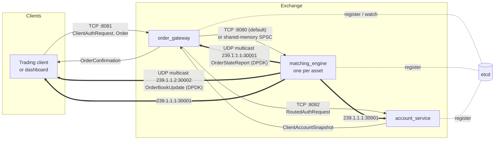
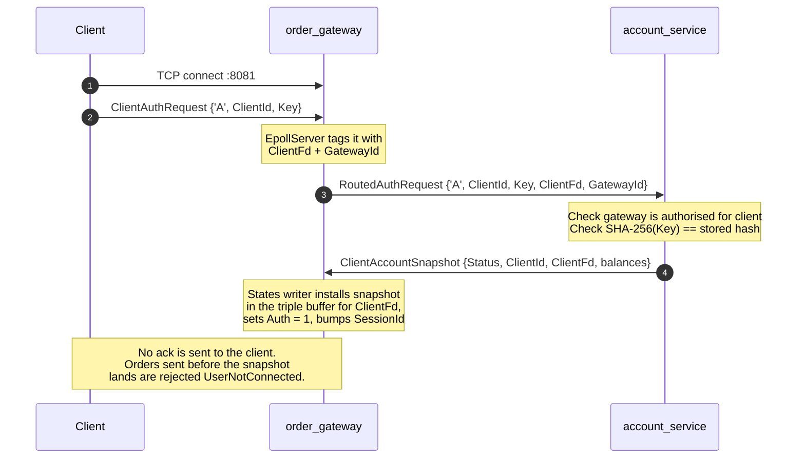
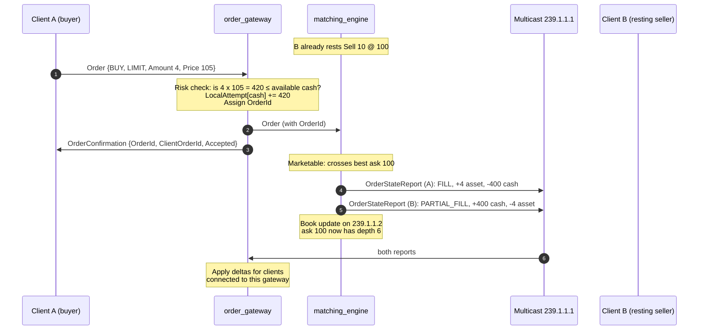
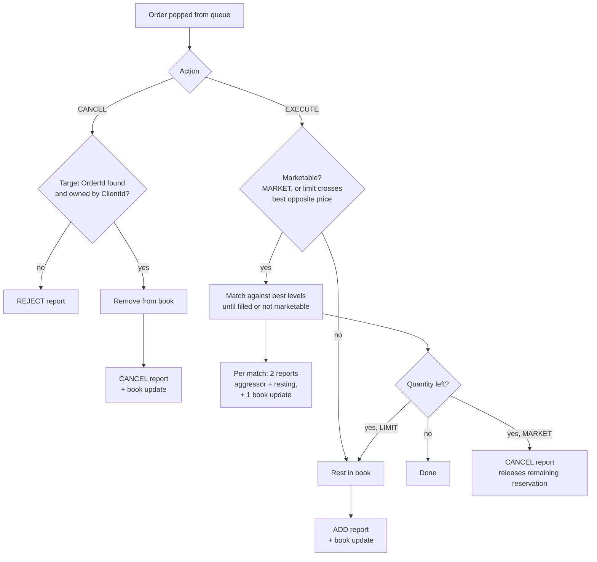

# Architecture

This document describes how Naoto Exchange is put together: the processes,
the threads inside them, how an order moves through the system, and how
client funds are tracked without a database on the hot path.

Wire formats are in [PROTOCOL.md](PROTOCOL.md). How to configure and run
everything is in [OPERATIONS.md](OPERATIONS.md). Where the latency numbers
come from is in [LATENCY.md](LATENCY.md).

Everything here is taken from the source at the time of writing. Where the
code and the intended design disagree, the difference is called out in
[Known gaps](#known-gaps).

---

## 1. System at a glance



Thick arrows are multicast sent with DPDK. Thin arrows are kernel TCP.
Dotted arrows are etcd service discovery.

| Process | Owns | Talks to |
|---|---|---|
| `order_gateway` | Client sessions, pre-trade risk check, order ID assignment, order acks | Clients (TCP), matching engines (TCP or shm), account service (TCP), trade-report feed (DPDK RX) |
| `matching_engine` | The order book for **one** asset, price-time matching | Gateways (TCP or shm in), multicast out (DPDK TX) |
| `account_service` | The authoritative copy of every client's balances and credentials | Gateways (TCP), trade-report feed (DPDK RX) |
| `trading_dashboard` | Manual trading UI, book view, latency statistics | Gateway (TCP), account service (TCP), both multicast feeds (kernel sockets) |
| `retransmitter` | *Work in progress, not functional.* Will answer gap-fill requests on the multicast channels. | |

### Why the system is split this way

- **The matching engine does nothing but match.** It never does a risk check
  or looks up a balance. Everything it needs is already in the order, and
  everything it produces goes out as a fire-and-forget multicast. That keeps
  the single most latency-critical thread free of I/O.
- **Risk runs in the gateway, against a local copy of the client's
  balances.** No network round trip to the account service happens on the
  order path. The gateway's copy is loaded once at login and then kept in
  sync from the same trade-report multicast every other service sees.
- **The account service replaces a database.** It holds client state in
  memory and keeps it current from the multicast feed, the same way the
  gateway does. Gateways query it only at login.
- **Market data and execution reports share one transport.** Every consumer
  (gateways, account service, dashboard, any external subscriber) gets the
  same packets. Nobody is waiting on a point-to-point reply.

---

## 2. Order lifecycle

### 2.1 Login

A client must authenticate on every new TCP connection. The first 37 bytes
on the connection are always a `ClientAuthRequest`.



There is no login acknowledgement on the wire. A client either waits a fixed
time after sending the auth request (the dashboard waits 100 ms), or treats
`UserNotConnected` rejects as "not ready yet".

### 2.2 New order, resting then filled



The ack (`OrderConfirmation`) is sent by the gateway after it has forwarded
the order, not by the matching engine. `Accepted` means "passed risk and was
handed to the engine". Fills and cancels are only ever visible on the
multicast feed.

### 2.3 What the matching engine does with an order



Matching is price-time priority: best price first, FIFO within a level. Every
event that changes the book produces one book update with the **absolute** remaining quantity at
the affected price level, so a book can be rebuilt from updates alone
(provided none were missed).

---

## 3. Inside each process

All three services follow the same pattern: one thread per job, busy-polling,
each pinned to a core, connected by single-producer/single-consumer (SPSC)
queues. Nothing on the hot path takes a lock or calls `malloc`. Every object
that moves between threads comes from a fixed-size pool allocated at
startup.

### 3.1 order_gateway

```
 ORDER PATH  (hot)

   client ──TCP──▶ EpollServer ──SPSC──▶ RiskEngine ──TCP or shm──▶ matching_engine
                   core 2                           core 4
                                          │     ▲
                                      ack │     │ reads a copy, never blocks
   client ◀──TCP── ClientMessageSender ◀──┘     │
                   core 10                      │
                                          ClientStates  (triple buffer, one entry per fd)
                                                ▲
                                                │ single writer
 STATE PATH                                     │
   TradeReportReceiver ───SPSC────▶ ClientStatesWriter ◀──SPSC── EpollServer
   core 11                              core 10                    (disconnects)
   ▲                                            ▲
   │ DPDK RX, 239.1.1.1                         │ SPSC (login snapshots)
                                                │
 LOGIN PATH                                     │
                                                │
   EpollServer ──SPSC──▶ AccountRequestSender   │
   (first message        core 11                │
    on a connection)          │ TCP             │
                              ▼                 │
                       account_service ──TCP──▶ AccountServiceResponseReceiver
                                                core 10
```

| Thread | Core | Job |
|---|---|---|
| `EpollServer` | 2 | Accepts client TCP, reads fixed-size messages, batches them. First message per fd is the auth request. Tags each batch with the fd and the client's current auth flag. |
| `RiskEngine` (`OrderRouter`) | 4 | Risk check, order ID assignment, forwards accepted orders to the engine for that asset, queues the ack. |
| `ClientMessageSender` | 10 | Writes acks back to client sockets, buffering partial writes per fd. |
| `ClientStatesWriter` | 10 | The **only** writer of client state. Applies trade reports, login snapshots and disconnects. |
| `AccountServiceResponseReceiver` | 10 | Reads `ClientAccountSnapshot`s from the account service socket. |
| `TradeReportReceiver` | 11 | DPDK RX of the trade-report multicast. |
| `AccountRequestSender` | 11 | Forwards auth requests to the account service. |

Cores are hard-coded in `order_gateway_service.hpp` for the reference
machine. See [OPERATIONS.md § Core layout](OPERATIONS.md#core-layout).

> **Known hotspot.** Three busy-polling threads share core 10. The scheduler
> time-slices them, so an item queued for one of them can wait a full
> scheduler slice (measured 1.5 ms median, 6 ms P99 in
> [BENCHMARKS.md](BENCHMARKS.md) § 2). This hits
> acks and client-state freshness, not the order path to the engine.

### 3.2 matching_engine

```
                          matching_engine (one asset)
 ┌─────────────────────────────────────────────────────────────────────┐
 │                                                                     │
 │  gateways ─TCP :8080─▶ [EpollServer] core 6 ─▶ OrderBatchQueue ─┐   │
 │                                                                 │   │
 │        or, with NAOTO_SHARED_MEMORY=ON:                         │   │
 │  gateway ─── shm SPSC "/me_gw_shm" (Order by value) ────────────┤   │
 │                                                                 ▼   │
 │                                         [BidAsk matching]  core 8   │
 │                                   state reports      book updates   │
 │                                      (SPSC) │          (SPSC) │     │
 │                                             ▼                 ▼     │
 │                           [TradeReportEmitter]  [OrderBookEmitter]  │
 │                              2nd EAL lcore         EAL main lcore   │
 │                              DPDK TX queue 1       DPDK TX queue 0  │
 └─────────────────────────────────────────────┼─────────────────┼─────┘
                                              ▼                 ▼
                                      239.1.1.1:30001   239.1.1.2:30002
```

| Thread | Core | Job |
|---|---|---|
| `EpollServer` | 6 | TCP mode only. Reads orders from gateways. |
| `MatchineEngine` (`BidAsk::MarketExecutionLoop`) | 8 | Matching. Single-threaded, owns the whole book. |
| Order book emitter | EAL main lcore (first core in `-l`) | Drains book updates, builds UDP packets, DPDK TX. |
| Trade report emitter | second EAL lcore (`-l`) | Drains order state reports, builds UDP packets, DPDK TX. |

**Book data structures** (`order_book.hpp`, one instance per side):

```
  price ──▶ FlatHashMap<int64 price, PriceLevel*>      O(1) lookup of a level
            SkipList<price, PriceLevel*>               ordered levels, head = best
  order id ─▶ FlatHashMap<uint64 id, OrderNode*>       O(1) cancel (shared by both sides)

  PriceLevel ── intrusive FIFO list ──▶ OrderNode ─▶ OrderNode ─▶ ...
  (price, total qty)                    (id, client, qty, price)
```

`OrderNode`, `PriceLevel` and skip-list nodes come from single-threaded pools
sized in `system_conf.hpp`. Running out of any of them means the sizing was
wrong. See [Known gaps](#known-gaps) for what happens today.

### 3.3 account_service

| Thread | Core | Job |
|---|---|---|
| `GatewayEpollServer` | 10 | TCP :8082. First message per fd is a 2-byte `GatewayHandshake` that maps the fd to a gateway ID. Then `RoutedAuthRequest`s. |
| `ClientRequestProcessor` | 11 | Validates the request and builds the `ClientAccountSnapshot` response. |
| `GatewayResponseDispatcher` | 11 | Sends each response to the gateway it came from, looked up by gateway ID. |
| `ClientStatesWriter` | 10 | Applies trade reports to the authoritative client state. |
| `TradeReportReceiver` | EAL main lcore | DPDK RX of 239.1.1.1:30001. Runs on the process's main thread. |

On startup the service is seeded with 12 demo clients (IDs 0-11), all
authorised on gateway 0, each with 10<sup>13</sup> units of assets 0-15. See
`account_service/src/main.cpp`. There is no persistence: a restart loses
every balance change.

---

## 4. Client funds model

This is the part most likely to surprise someone reading the code for the
first time.

### 4.1 Confirmed and Attempt

Each client holds up to `MaxPositions` (16) positions. A position is an
asset ID plus two signed 64-bit counters:

| Field | Meaning |
|---|---|
| `Confirmed` | What the client owns. Changes only on fills. |
| `Attempt` | How much of `Confirmed` is reserved by open orders. |

Available to trade = `Confirmed - Attempt`.

**Asset 0 is the settlement currency.** Every engine trades one asset against
asset 0. A buy reserves `Amount × Price` of asset 0; a sell reserves `Amount`
of the traded asset. Prices and amounts are plain integers. There is no
decimal scaling anywhere in the system.

### 4.2 How every report changes a balance

An `OrderStateReport` always describes one client's side of an event as
"what came in" and "what went out":

```
  BoughtAssetId  += BoughtDelta                     (Confirmed)
  SoldAssetId    += SoldDelta                       (Confirmed)
  SoldAssetId    += SoldAttemptDelta                (Attempt)
```

Worked example, asset 1 traded against cash (asset 0). B rests
`SELL 10 @ 100`, then A sends `BUY 4 @ 105`:

| Event | Client | Bought (id, Δ) | Sold (id, Δ) | SoldAttemptΔ | State |
|---|---|---|---|---|---|
| B's order rests | B | (0, 0) | (1, 0) | +10 | ADD |
| A crosses at 100 | A | (1, +4) | (0, −400) | −400 | FILL |
| same match | B | (0, +400) | (1, −4) | −4 | PARTIAL_FILL |

The trade price is not on the wire. It is `−SoldDelta / BoughtDelta` from the
buyer's report: 400 / 4 = 100.

### 4.3 Reservations in the gateway

The gateway must reserve funds the moment an order passes risk, before the
engine has seen it. Otherwise two orders sent back to back could both spend
the same balance. It does this with a per-connection `LocalAttempts` counter
that only the risk thread touches:

```
  available = Confirmed − (Attempt + LocalAttempt)

  on Accepted:        LocalAttempt[asset] += reserved amount
  on ADD report:      ignored for Attempt  (already counted in LocalAttempt)
  on FILL / CANCEL:   Attempt += SoldAttemptDelta  (negative: releases)
  on new SessionId:   LocalAttempt cleared (fresh snapshot from account service)
```

So for a resting order the reservation lives in `LocalAttempt` and is
released through `Attempt` going negative by the same amount. The net is
correct, but the two counters individually are not meaningful.

### 4.4 Triple-buffered client state

The risk thread reads client state on every order; the states writer updates
it on every trade report. They run on different cores and must not block
each other. `ClientStates` (in both the gateway and the account service)
keeps three copies of every client and a per-client index of which copy is
currently readable:

```
          Complete[client] = 1  (release-stored by writer)
                 │
     ┌───────────┼───────────┐
     ▼           ▼           ▼
  States1     States2     States3
  (stale)     READ HERE   WRITE NEXT
               ▲               │
   risk thread │               │ states writer applies deltas,
   copies it   │               │ then advances Complete to 2
   (acquire)
```

The writer accumulates *deltas* per buffer, not absolute values, then folds
them forward on each flush so the next write buffer is current. Readers copy
the whole `ClientState` out (320 bytes, 5 cache lines) and work on the copy.

The reader is never blocked. The cost: a reader that is pre-empted for longer
than two writer flushes of the same client can copy a mix of two
generations. Nothing detects this today. Measured rates are in
[BENCHMARKS.md](BENCHMARKS.md) § 3.

The gateway indexes client state **by socket fd**, the account service **by
client ID**.

---

## 5. Transports

| Hop | Transport | Framing |
|---|---|---|
| Client ↔ gateway | Kernel TCP, `TCP_NODELAY` | Fixed-size packed structs, back to back. No length prefix, no message type byte. |
| Gateway → engine | Kernel TCP (default) or POSIX shared memory | Same `Order` struct as the client sends, with `OrderId` filled in. |
| Gateway ↔ account service | Kernel TCP | 2-byte handshake, then fixed-size structs. |
| Engine → everyone | UDP multicast built by hand and sent with DPDK | Up to 16 structs packed into one datagram. No packet header; each struct carries its own sequence number. |

Because there is no message-type field, **each TCP connection carries exactly
one message type in each direction**, and both ends must agree on the struct
size. The sizes change with `NAOTO_PERF` (see [PROTOCOL.md](PROTOCOL.md)),
so every binary that talks to another must be built with the same option.

### Shared-memory mode

With `-DNAOTO_SHARED_MEMORY=ON` the gateway-to-engine hop becomes a single
`SpscQueue<Order, 32768>` placed in the POSIX shared memory object
`/me_gw_shm` (`/dev/shm/me_gw_shm`). The engine creates it on startup and
wipes any stale one first. The gateway retries `shm_open` every 100 ms until
it exists.

Trade-offs:

- One gateway and one engine. SPSC means exactly one producer.
- No etcd-driven engine discovery. The gateway skips the
  `/matching-engines/` watch entirely.
- No TCP stack on the order path. This is the configuration the headline
  latency numbers were measured in.

---

## 6. Service discovery and elasticity

Every service registers itself in etcd under a 10-second lease with
keep-alive. If a process dies, its key disappears within 10 s.

| Key | Written by | Value |
|---|---|---|
| `/matching-engines/<SYMBOL>` | matching engine | `{"addr":"127.0.0.1:8080","asset_id":1,"status":"active"}` |
| `/socket-gateways/<MACHINE_ID>` | gateway | `{"ip":"localhost:8081","status":"active"}` |
| `/account-service/0` | account service | `{"addr":"127.0.0.1:8082","status":"active"}` |

Note `socket-gateways` uses `"ip"` where the others use `"addr"`.

The gateway lists, then watches, `/matching-engines/` and
`/account-service/`:

- **PUT** on a matching engine key: connect to the new address, swap it into
  the slot for that asset ID. New assets come online without restarting
  gateways.
- **PUT** on the account service key: connect, send the handshake, swap.
- **DELETE**: mark the slot dead (fd −1). Orders for that asset are rejected
  `TechnicalFailure` until a replacement registers.

Connection slots are `VersionedFd`: a 32-bit fd and a 32-bit generation
packed in one `std::atomic<uint64_t>`. The etcd callback thread swaps it;
sender threads load it, send, and reload to detect a swap during the send.

---

## 7. Sequence numbers and recovery

Each multicast channel has its own 32-bit sequence counter, assigned by the
emitter as the struct is copied into the packet. It starts at 0 when the
engine starts and increments by one per struct, not per packet.

Intended recovery model (from the design notes in the root README):

| Data | Policy |
|---|---|
| Order state reports | Never dropped. A consumer that misses one must recover it. |
| Book updates | Recoverable through sequence-gap resync. |
| Pool exhaustion | Means a sizing assumption was wrong. Not a condition to degrade through. |

Current state: consumers do not detect gaps, and there is no snapshot or
retransmission service yet (`market_server/retransmitter/` is a stub). A
subscriber that joins late, or drops a packet, has no way to rebuild the
book. The gateway keeps the last 8192 trade reports in a ring
(`UpdatesBuffer`) to replay reports that arrive between an account-service
snapshot and its installation. See [Known gaps](#known-gaps) for why that
replay is not yet correct.

---

## Known gaps

These are the places where the code does not yet do what the design says.
Each was found by reading the source; none of them is hidden by the
documentation above.

1. **No gap detection or recovery on multicast.** See § 7.
2. **Snapshot sequence ID is always 0.** `ClientRequestProcessor` sets
   `ClientAccountSnapshot::SequenceId = 0`, so the gateway cannot tell which
   trade reports a snapshot already includes. Its replay either re-applies
   every buffered report for that client (double counting) or, once the
   8192-entry ring has wrapped, discards the snapshot as stale and the login
   never completes.
3. **Buy-side reservations leak on price improvement.** A `BUY 4 @ 105` that
   fills at 100 reserves 420 and releases 400. The remaining 20 is released
   only for `MARKET` orders (via the trailing CANCEL report). For a fully
   filled limit order it stays reserved for the rest of the session.
4. **Marketable orders skip the account service's reservation.** The account
   service only reserves on ADD. An order that fills on arrival never ADDs,
   but its fills still release `Attempt`, so the account service's `Attempt`
   goes negative and the next login snapshot shows more available balance
   than the client has. This is the "market order fill updates" issue in the
   root README's Status section.
5. **Order IDs are truncated to 32 bits.** The gateway builds
   `GatewayId << 48 | counter`, but stores it in the 32-bit
   `OrderConfirmation::OrderId` first, so the gateway ID is lost. Two
   gateways will issue colliding IDs.
6. **Two environment variables name the gateway.** `GATEWAY_ID` is put into
   auth requests (the account service routes the reply by it). `MACHINE_ID`
   is sent in the handshake and used for order IDs and the etcd key. If they
   differ, login replies go to the wrong gateway.
7. **Pool exhaustion is not handled uniformly.** Some paths `std::terminate`,
   some log and continue, some dereference a null pointer. Search for
   `TODO` near `Acquire()` calls.
8. **Login has no acknowledgement**, and there is no logout message. The
   account service's `'D'` (disconnect) branch is empty.
9. **The dashboard and the account service disagree on the etcd key.** The
   dashboard discovers the account service under `/client-details-provider/`;
   the service registers `/account-service/0`. Workaround in
   [OPERATIONS.md § 7](OPERATIONS.md#7-troubleshooting).
